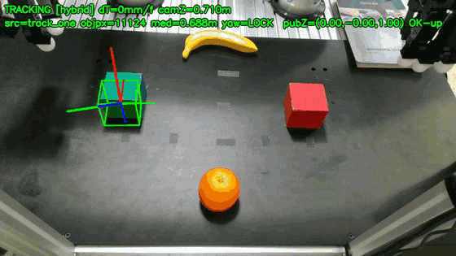
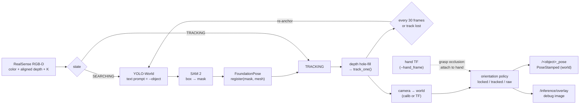
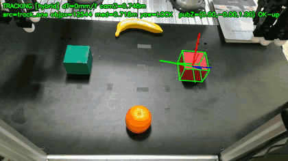
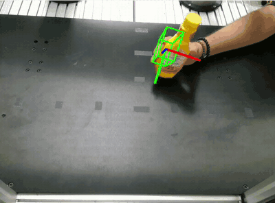
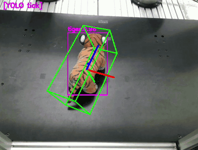
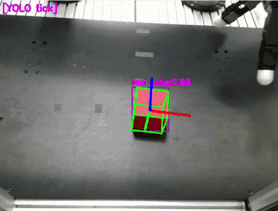
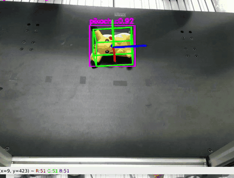
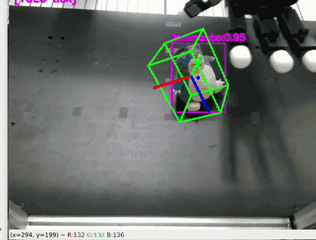
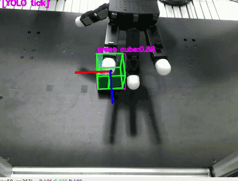
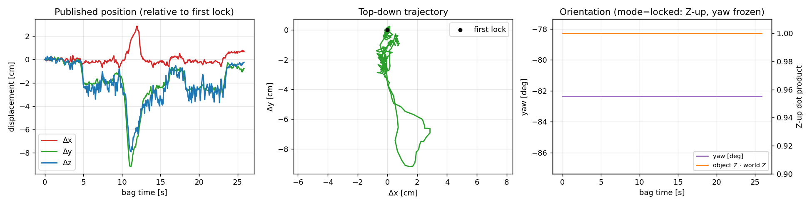

# FoundationPose ROS 2 Tracker

[](https://github.com/ismael-esp/foundationpose-ros2-tracker/actions/workflows/lint.yml)

**Zero-shot 6D object tracking in ROS 2 from just a 3D mesh and an object name.**
Type `--object "green cube"`, and the node finds the object with an open-vocabulary detector
(YOLO-World), segments it (SAM 2), registers its full 6D pose with
[FoundationPose](https://github.com/NVlabs/FoundationPose), and then tracks it in real time, publishing a
`geometry_msgs/PoseStamped` that a robot can grasp from. It needs no per-object training and no markers.

<p align="center">
  
  <br/>
  <sub>Offline replay of a recorded RealSense D4xx bag (2× speed). The only inputs were <code>green_cube.obj</code>
  and the prompt <code>"green cube"</code>. The red cube, banana and orange are distractors.
  Thin axes: raw FoundationPose pose. Thick axes: gravity-aligned published pose (Z up).</sub>
</p>

**Project page with videos:** https://ismael-esp.github.io/foundationpose-ros2-tracker/

This is the perception front end of a dual-arm UR3 + Allegro Hand pick-and-place cell. The published
pose feeds a dexterous grasp planner that grasps the object.

---

## Contents

- [Highlights](#highlights)
- [How it works](#how-it-works)
- [Results](#results)
- [Requirements](#requirements)
- [Installation](#installation)
- [Quick start: offline demo (no camera)](#quick-start-offline-demo-no-camera)
- [Live use with a RealSense camera](#live-use-with-a-realsense-camera)
- [Configuration](#configuration)
- [Outputs (ROS 2 interface)](#outputs-ros-2-interface)
- [Other tools in this repo](#other-tools-in-this-repo)
- [Troubleshooting](#troubleshooting)
- [Repository layout](#repository-layout)
- [Acknowledgements & licenses](#acknowledgements--licenses)

## Highlights

- **Training-free detection.** YOLO-World is prompted with the object name (plus optional aliases), and
  SAM 2 turns the box into a mask. No dataset or fine-tuning is needed. If the auto-detector misses, you can
  click the object instead.
- **6D pose from a CAD mesh.** FoundationPose `register()` gives the first pose. Every frame after that
  uses `track_one()`, which is smooth and temporally consistent, so the axes don't flicker.
- **Self-healing tracking.** A hybrid loop re-anchors with YOLO-World→SAM 2 every N frames to correct
  drift. It also re-acquires automatically when the track is lost, and a reacquisition gate keeps a lost
  track from deadlocking.
- **Robot-ready output.** The pose is published in the `world` frame. The `locked` orientation mode
  forces the object Z axis up and freezes yaw at first lock, so a symmetric cube's pose doesn't spin.
  During a grasp, when the hand occludes the object, the pose is rigidly attached to the hand TF and
  re-locks to vision afterwards.
- **Works with sparse depth.** Depth hole-filling before `track_one` fixes the "frozen box" failure
  on small, far objects. The node uses TF32 automatically on Ampere and newer GPUs, and adapts
  refinement iterations to tracking quality.
- **Runs on RTX 50xx (Blackwell, sm_120).** A small patch brings FoundationPose's CUDA extensions up to
  PyTorch 2.11 + CUDA 12.8 (see [`patches/`](patches/)).

## How it works



1. **Detect once.** The open-vocabulary YOLO-World model (`yolov8l-worldv2.pt` by default) is prompted
   with the object name. The highest-scoring box goes to SAM 2 (`sam2.1_b.pt`), which returns the mask.
   In `auto_confirm` mode (the default) a window shows the proposal: **Enter/Space** accepts it,
   **click** picks the object manually, **r** retries and **q** quits.
2. **Register.** FoundationPose registers the mesh against the masked RGB-D frame and returns the
   object pose in the camera optical frame.
3. **Track.** `track_one()` runs every frame, starting from the previous pose. Every
   `--reanchor_period` frames, and on track loss, the detector runs again and re-registers if the
   detection is consistent (a size gate rejects detections between 0.25× and 4× of the original mask).
4. **Publish.** The pose is lifted to `world` using a stored extrinsic calibration or the live TF tree,
   then post-processed according to `--orientation_mode` and published at the tracking rate.

## Results

### Same recording, different name: `--object "red cube"`

<p align="center"></p>

Changing only the prompt and mesh switches the target. The green cube is now the distractor.

### Live tracking on the robot cell (real RealSense, top-down head camera)

| | | |
|:-:|:-:|:-:|
|  |  |  |
| mustard bottle, moved by hand | plush tiger (non-convex) | red cube during pick-and-place |
|  |  |  |
| plush toy, grasped by Allegro hand | plush toy | green cube |

<sub>These clips come from the multi-object node <code>fp.py</code>, which uses a YOLO detector trained per object
(magenta "YOLO tick" boxes). The training-free single-object node <code>foundation_pose.py</code> uses the same
FoundationPose tracking core.</sub>

### Full system: perception → grasp planning → dual UR3 + Allegro pick-and-place

- [`pick_place_red_cube_system.mp4`](docs/media/pick_place_red_cube_system.mp4): RViz robot state, tracker
  window and lab camera, red cube
- [`pick_place_tiger_system.mp4`](docs/media/pick_place_tiger_system.mp4): the same setup with the plush tiger
- [`pick_place_red_cube_cameras.mp4`](docs/media/pick_place_red_cube_cameras.mp4): top-down overlay during the grasp
- [`replay_green_cube.mp4`](docs/media/replay_green_cube.mp4): full-resolution version of the GIF above

(GitHub doesn't play repo videos inline. The [project page](https://ismael-esp.github.io/foundationpose-ros2-tracker/)
embeds all of them.)

### Sample run data

[`docs/sample_run/`](docs/sample_run/) holds the raw output of the green-cube replay above:

| File | Content |
|---|---|
| [`green_cube_poses.csv`](docs/sample_run/green_cube_poses.csv) | 345 published poses: `t_bag_sec, frame_id, x, y, z, qx, qy, qz, qw` |
| [`green_cube_node_log.txt`](docs/sample_run/green_cube_node_log.txt) | Node log: model load → YOLO-World detection (conf 0.70) → `register OK` → tracking telemetry |
| [`green_cube_trajectory.png`](docs/sample_run/green_cube_trajectory.png) | Plot of the published trajectory and orientation |

<p align="center"></p>

The cube is picked up and put back (about 9 cm of motion), and the lock holds throughout. In `locked` mode the published orientation stays exactly
Z-up, with yaw frozen at first lock (std 0.0°), which is what a grasp planner wants for a symmetric cube.
(The `world` frame in this replay uses the head-camera calibration preset, so read the plot as relative
motion.)

Measured throughput is about 3–5 Hz end-to-end with the debug overlay enabled (RTX 5070 Ti,
1024×576, TF32). The node prints a 1 Hz `[perf]` line with per-stage timings.

## Requirements

| | Tested with |
|---|---|
| OS | Ubuntu 22.04 |
| ROS 2 | Humble (`rclpy`, `tf2_ros`, `sensor_msgs`, `geometry_msgs`) |
| GPU | NVIDIA RTX 5070 Ti 16 GB (sm_120). Any CUDA GPU with ≥ 8 GB should work. |
| Driver / CUDA | 570.144 / CUDA toolkit 12.8 |
| Python env | conda, Python 3.10, PyTorch 2.11.0+cu128, NumPy 1.26 (**NumPy must stay < 2** for ROS Humble) |
| Camera | Intel RealSense D415 / D435 via [`realsense-ros`](https://github.com/IntelRealSense/realsense-ros), with depth aligned to color |

[`scripts/env/fp_ros_pip_freeze.txt`](scripts/env/fp_ros_pip_freeze.txt) is the exact `pip freeze` of the working environment.

## Installation

```bash
git clone https://github.com/ismael-esp/foundationpose-ros2-tracker.git
cd foundationpose-ros2-tracker
bash scripts/install.sh            # creates conda env "fp_ros"; override with ENV_NAME=... TORCH_CUDA=cu121
```

`install.sh` does the following, and every step can also be run by hand:

1. creates a Python 3.10 conda env and installs PyTorch, `requirements.txt`, CLIP (for YOLO-World), Eigen,
   pybind11 and PyTorch3D
2. clones **NVlabs/FoundationPose** at commit `e3d597b` into `FoundationPose/` and applies
   [`patches/foundationpose_blackwell_cu128.patch`](patches/foundationpose_blackwell_cu128.patch), which
   replaces the deprecated `Tensor.type()` dispatch, fixes the `dim3` narrowing, switches to C++17 and uses
   a flat `import mycpp`
3. downloads the two pretrained FoundationPose weight folders (refiner + scorer) with `gdown`
4. builds **nvdiffrast**, **mycpp** (C++/pybind11) and **mycuda** (CUDA extension) against your PyTorch
5. installs a conda activation hook that puts torch's `lib/` on `LD_LIBRARY_PATH`, which the
   nvdiffrast JIT plugin needs

The YOLO-World and SAM 2 weights are downloaded automatically by Ultralytics on the first run.

Then verify the install:

```bash
conda activate fp_ros
source /opt/ros/humble/setup.bash
python scripts/check_install.py
```
```
  [ OK ] torch + CUDA - torch 2.11.0+cu128, NVIDIA GeForce RTX 5070 Ti
  [ OK ] numpy < 2 - 1.26.4
  [ OK ] nvdiffrast
  [ OK ] mycpp (C++ ext)
  [ OK ] mycuda (CUDA ext)
  [ OK ] pytorch3d - 0.7.9
  [ OK ] FoundationPose estimater
  [ OK ] FoundationPose weights - 2023-10-28-18-33-37, 2024-01-11-20-02-45
  [ OK ] ultralytics (YOLO-World + SAM2) - 8.3.31
  [ OK ] rclpy (source /opt/ros/humble/setup.bash)
```

> **Older GPUs (RTX 20/30/40):** `TORCH_CUDA=cu121 bash scripts/install.sh` also works. The patch is
> harmless on older architectures.

## Quick start: offline demo (no camera)

A recorded RGB-D bag of four objects on the table (24 s, 1024×576, ~1 GB) is attached to the
[v1.0 release](https://github.com/ismael-esp/foundationpose-ros2-tracker/releases/tag/v1.0).
The demo script downloads it to `data/` on first use, starts the tracker on an isolated ROS domain,
plays the bag, and records the overlay and poses:

```bash
bash scripts/replay_demo.sh                 # tracks "green cube"
bash scripts/replay_demo.sh "red cube"      # same bag, different target, nothing else changes
```
```
==> Loading models (log: runs/replay/green_cube.node.log) ...
==> Playing data/front_4obj_move_db3 at 0.5x
[WARN] [...] [YOLO-World] 1 det -> top by score (conf-only): green cube:c=0.70
[WARN] [...] [register OK] mask=9620px mask_med_depth=0.689m -> obj cam_xyz=(-0.235,-0.047,0.710) ...
==> Overlay: runs/replay/green_cube.mp4   Poses: runs/replay/green_cube_poses.csv
```

To try your own recording, pass the bag path and playback rate:
`bash scripts/replay_demo.sh "mustard" path/to/bag 0.5`. The bag needs the topics
`/camera/camera/{color/image_raw, aligned_depth_to_color/image_raw, color/camera_info}`.
Add `--viz_local` at the end (for example `bash scripts/replay_demo.sh "red cube" "" 0.5 --viz_local`) to
watch in an OpenCV window. In that mode the node draws to the window instead of publishing the overlay
topic, so no MP4 is recorded.

## Live use with a RealSense camera

**1. Start the camera** with depth aligned to color:

```bash
source /opt/ros/humble/setup.bash
ros2 launch realsense2_camera rs_launch.py align_depth.enable:=true \
    rgb_camera.color_profile:=640x480x30 depth_module.depth_profile:=640x480x30
```

**2. Run the tracker**, giving it the object name and your camera topics:

```bash
bash scripts/run_tracker.sh "red cube" \
    --color_topic /camera/camera/color/image_raw \
    --depth_topic /camera/camera/aligned_depth_to_color/image_raw \
    --camera_info_topic /camera/camera/color/camera_info \
    --cam_frame camera_color_optical_frame
```

or call the node directly:

```bash
conda activate fp_ros && source /opt/ros/humble/setup.bash
python3 foundation_pose.py --object "red cube" --hand_frame ra_palm_link --viz_local [topic flags...]
```

**3. Confirm the detection.** A window shows the YOLO-World→SAM 2 proposal.

| Key | Action |
|---|---|
| **Enter / Space** | accept the proposal |
| **mouse click** | pick the object yourself (SAM 2 from the clicked point) |
| **r** | redo the automatic detection |
| **q / Esc** | cancel |
| **n** (while tracking) | drop the lock and re-detect |

**4. Use the pose:** `ros2 topic echo /red_cube_pose`.

## Configuration

### Adding your own object

1. Put a mesh in **metres** at `demo_data/<name>/<name>.obj` (`.stl` also works). The folder and file
   stem are the object name, so `demo_data/red_cube/red_cube.obj` → `--object "red cube"` →
   topic `/red_cube_pose`. Spaces and underscores are interchangeable.
2. Check the units and size:
   ```bash
   python scripts/check_mesh.py "red cube"
   ```
   ```
   mesh                                       extents [m]                diam   verts  verdict
   demo_data/red_cube/red_cube.obj            [0.086 0.082 0.071]       0.138    6889  ok
   ```
   A mesh exported in mm or cm (diameter of metres) registers far away and the box explodes on
   screen. Rescale such meshes before use. Meshes above about 100k vertices work but slow things down,
   so decimate them.
3. If the name alone is ambiguous to YOLO-World, add synonyms:
   `--object "mustard" --object_aliases "yellow bottle,sauce bottle"`. Check what YOLO-World sees with
   `python yoloworld_preview.py --object "mustard"`.

Mesh sources that work well: a phone photogrammetry scan (e.g. Polycam or Kiri Engine, exported as
OBJ and scaled to metres), the YCB object set, or a CAD model.

### Camera and calibration

The tracker publishes in `world`. Choose how the camera→world transform is obtained:

| `--cam_world_source` | Behaviour |
|---|---|
| `calib` (default) | uses the extrinsic stored in the `CAMERAS` preset in `foundation_pose.py`, so no TF is needed |
| `tf` | looks up `world → <cam_frame>` from the live TF tree |
| `auto` | tries TF first, falls back to the stored calibration |

`--camera {head, front, extra}` selects a preset (topics, optical frame and calibration). To add your
own camera, copy a preset in the `CAMERAS` dict, set its topics and frame, and paste your extrinsic
(`x y z qx qy qz qw` of `world → camera_color_optical_frame`). `cam_2_base_transform.py` has helpers for
computing it. Any preset field can be overridden on the command line with `--color_topic`,
`--depth_topic`, `--camera_info_topic` and `--cam_frame`.

### Main flags

| Flag | Default | Meaning |
|---|---|---|
| `--object` | required | object name: mesh lookup, YOLO-World prompt and topic name |
| `--hand_frame` | required | TF frame of the gripper/hand. While the object is occluded in a grasp, it moves rigidly with this frame. Any frame name works if you don't use it. |
| `--detect_mode` | `auto_confirm` | `auto` (no window), `auto_confirm`, `click` |
| `--auto_detector` | `yoloworld` | `depthcluster` = tabletop depth clustering instead (fallback) |
| `--object_aliases` | `""` | extra comma-separated prompts |
| `--yolo_world_size` | `l` | `s/m/l/x`: speed vs. recall |
| `--det_conf` | `0.30` | YOLO-World confidence threshold |
| `--track_mode` | `hybrid` | `hybrid` (track + periodic re-anchor), `track_one`, `reregister` |
| `--reanchor_period` | `30` | frames between drift checks |
| `--orientation_mode` | `locked` | `locked` = Z up + yaw frozen · `tracked` = Z up + live yaw · `raw` = full 6D as estimated |
| `--est_refine_iter` | `2` | refinement iterations for registration |
| `--track_refine_iter_min/max` | `1 / 4` | adaptive refinement while tracking (rises when IoU or motion looks bad) |
| `--depth_fill` / `--no_depth_fill` | on | fill holes in sparse depth before `track_one` |
| `--precision` | `auto` | `auto` → TF32 on sm ≥ 80, `fp32`, `bf16` (falls back to fp32 automatically) |
| `--viz_local` | off | show the OpenCV viewer (needed for confirm/click). This replaces the overlay topic. |

Run `python3 foundation_pose.py --help` for all ~70 options.

## Outputs (ROS 2 interface)

| Topic | Type | Content |
|---|---|---|
| `/<object>_pose` | `geometry_msgs/PoseStamped` | object pose, `frame_id = world`, stamped with the camera time |
| `/inference/overlay` | `sensor_msgs/Image` | debug overlay (RELIABLE) |
| `/inference/overlay_be` | `sensor_msgs/Image` | same image, BEST_EFFORT (for remote viewers) |

The overlay topics are published only without `--viz_local`. With `--viz_local`, the same image is
shown in a local OpenCV window instead.

Subscribed: the color, depth and camera_info topics, plus TF (only for `--hand_frame`, and for camera→world
when `--cam_world_source tf/auto`).

Record any live or replayed session to MP4 + CSV:

```bash
python scripts/record_overlay.py --pose_topic /red_cube_pose --out runs/live/red_cube --duration 60
```

## Other tools in this repo

| Script | Purpose |
|---|---|
| `foundation_pose.py` | **The training-free single-object tracker** described above |
| `test_foundation_pose.py` | Multi-object switcher: loads the networks once, then switches the target object at runtime (`]` / `[` / `1`–`9`), without restarting |
| `fp.py` | Earlier multi-object node: tracks several objects in parallel with a YOLO detector trained per object (`--detector_weights your.pt`) |
| `foundationpose_ros_multi.py` | Original multi-object node with a Tkinter object/mask selector |
| `yoloworld_preview.py` | Shows what YOLO-World detects for a prompt (live topic or `--image file.png`) |
| `yolo_det_preview.py` | Preview for a fixed-class YOLO model |
| `cam_2_base_transform.py` | Camera↔robot-base transform helpers for extrinsic calibration |
| `record.py` | Records an RGB-D stream (ZMQ) into a ROS 2 bag for later replay |
| `debug_rgbd_stats.py` | Prints shape, dtype and valid-depth statistics of the incoming streams |
| `scripts/` | `install.sh`, `check_install.py`, `check_mesh.py`, `run_tracker.sh`, `replay_demo.sh`, `record_overlay.py` |

## Troubleshooting

| Symptom | Fix |
|---|---|
| `ImportError … nvdiffrast_plugin … libc10.so` | torch's `lib/` isn't on `LD_LIBRARY_PATH`. Re-activate the env (the install hook sets it) or `export LD_LIBRARY_PATH=$(python -c 'import torch,os;print(os.path.dirname(torch.__file__))')/lib:$LD_LIBRARY_PATH` |
| `cv_bridge` / `numpy.core.multiarray failed to import` | NumPy 2 got installed: `pip install "numpy<2"`. The nodes do their own image conversion and never need `cv_bridge`. |
| `type object 'module' has no attribute '_TYPE_SUPPORT'` | Keep `from estimater import *` **before** the ROS message imports, because `estimater` exports a PIL `Image` that would shadow `sensor_msgs.msg.Image` |
| Box explodes or appears metres away | The mesh isn't in metres: run `scripts/check_mesh.py` |
| Box freezes where it first locked while the object moves | Depth is too sparse at the object. Keep `--depth_fill` on, move the camera closer (< 1 m) or use a top-down view |
| YOLO-World picks the wrong object | Add `--object_aliases`, raise `--det_conf`, use `--detect_mode auto_confirm` and click, or test prompts with `yoloworld_preview.py` |
| Symmetric object's axes spin | Use `--orientation_mode locked` (default) with `--track_mode hybrid` |
| `no kernel image is available` on RTX 50xx | PyTorch or an extension was built without sm_120. Use a `cu128` PyTorch and rebuild nvdiffrast/mycuda (`install.sh` steps 4–6) |
| `Low precision dtypes not supported` | You forced `--precision bf16`. The node reverts to fp32 automatically; use `auto` |

## Repository layout

```
foundation_pose.py            training-free single-object tracker (main entry point)
test_foundation_pose.py       runtime multi-object switcher on top of it
fp.py, foundationpose_ros_multi.py   earlier multi-object trackers
yoloworld_preview.py, yolo_det_preview.py, debug_rgbd_stats.py, record.py, cam_2_base_transform.py
demo_data/<object>/<object>.obj      object meshes (metres)
patches/                      FoundationPose patch for PyTorch 2.11 / CUDA 12.8 / sm_120
scripts/                      install, checks, run/replay/record helpers, env freeze
docs/                         project page, media, sample run data
FoundationPose/   (created by install.sh, not tracked)   NVlabs FoundationPose + weights + extensions
data/, runs/      (created at runtime, not tracked)      replay bags, recordings
```

## Acknowledgements & licenses

- **[FoundationPose](https://github.com/NVlabs/FoundationPose)** (Wen et al., CVPR 2024), the pose
  estimator and tracker. It is under the NVIDIA Source Code License and is **not redistributed here**:
  `install.sh` fetches it, and only a small patch is shipped. Its license restricts use to
  non-commercial purposes.
- **[FoundationPoseROS2](https://github.com/ammar-n-abbas/FoundationPoseROS2)** by Ammar N. Abbas, the
  original ROS 2 wrapper this project started from (MIT). `foundationpose_ros_multi.py` comes from it.
- **[YOLO-World](https://github.com/AILab-CVC/YOLO-World)** and **[SAM 2](https://github.com/facebookresearch/sam2)**
  via [Ultralytics](https://github.com/ultralytics/ultralytics) (AGPL-3.0).
- Some meshes in `demo_data/` (`drill`, `mustard`, `soup_can`) come from the FoundationPose demo data and the
  [YCB object set](https://www.ycbbenchmarks.com/). The others were scanned or modelled for this project.

The code in this repository is released under the [MIT License](LICENSE). Third-party components keep
their own licenses.

```bibtex
@InProceedings{foundationposewen2024,
  author    = {Bowen Wen and Wei Yang and Jan Kautz and Stan Birchfield},
  title     = {{FoundationPose}: Unified 6D Pose Estimation and Tracking of Novel Objects},
  booktitle = {CVPR},
  year      = {2024}
}
```

---

Developed 2025-2026 by Ismael Espinoza Jaramillo (PhD candidate, Kyung Hee University) in the lab's private workspace and published here as a clean snapshot in Oct 2026 · [ismael-esp.github.io](https://ismael-esp.github.io) · [github.com/ismael-esp](https://github.com/ismael-esp)
